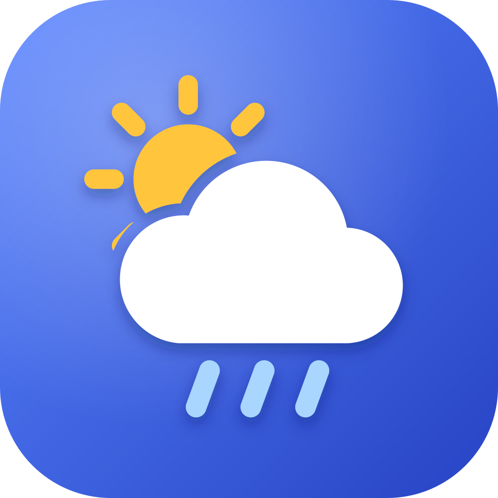
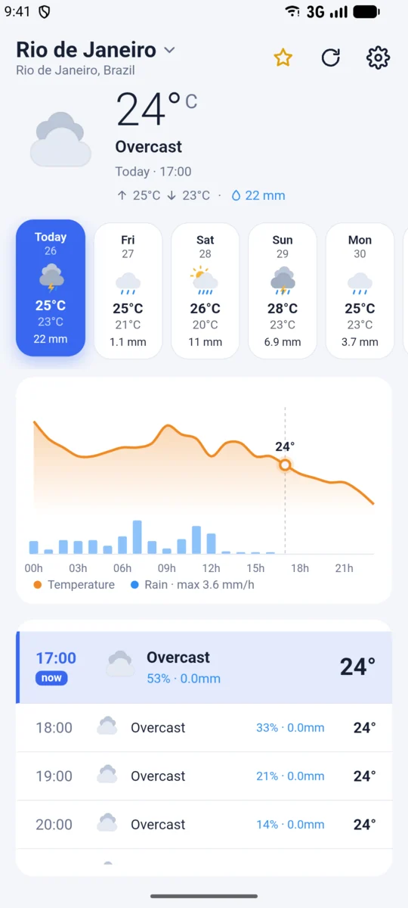
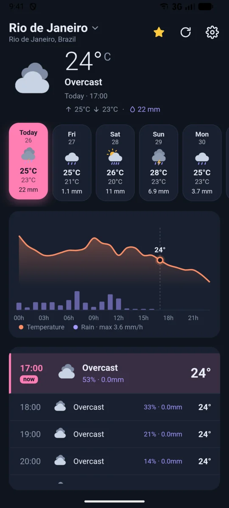
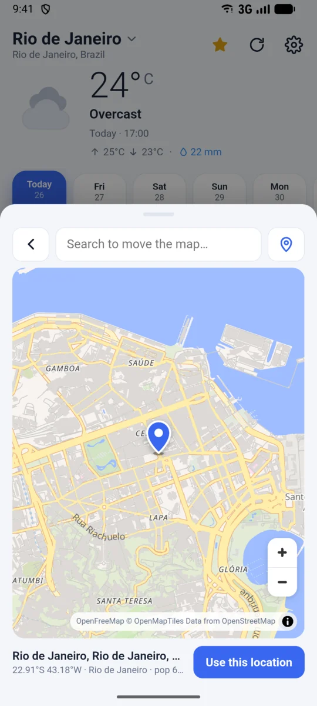
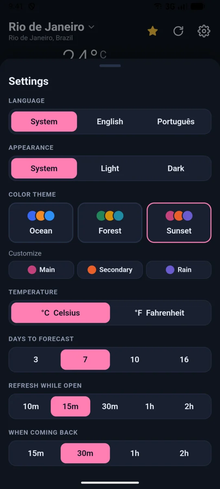
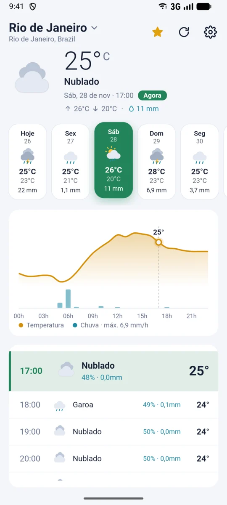
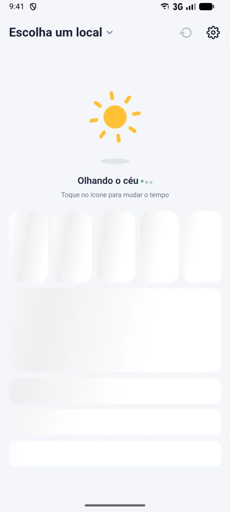

<div align="center">



# Forecast

**A fast, private hourly weather app for Android: Rust inside, Svelte outside.**

No accounts, no API keys, no trackers. Just the forecast.


<br />

&nbsp;
&nbsp;


</div>

## Features

### 🌦️ The forecast

- **Hour by hour.** Days scroll along the top, and a temperature and rain chart sits below them. Drag across the chart to scrub through the day.
- **The selected hour stands out.** The hour list scrolls on its own and brings the selected hour to the top, shown larger. A **now** badge marks the current hour.
- **Animated weather icons.** Rain and snow fall, the sun turns, clouds drift and lightning flickers.
- **3, 7, 10 or 16 days**, in **°C or °F**, with rain probability and millimeters per hour.

### 📱 Home-screen widget

- **The chart on your home screen,** with **‹ day ›** arrows to browse the forecast, the current temperature, and the day's high, low and rain.
- **Stays fresh on its own:** the app shares every forecast it loads, and the widget also refreshes in the background (every 15 min to 4 h, 30 min by default).
- **A clock built in:** big (time and date, the default), small (next to the temperature) or off. Tap it to open your clock app.
- **See-through if you like:** background from 100% down to fully transparent; below 50% the text turns white with a shadow.
- **Pick what it shows:** location, current conditions, the day summary, the arrows, the refresh button and the rain bars can each be switched on or off. It resizes from 3×2 and follows the app's palette, theme, units and language.

### 📍 Locations

- **City search** in the language you use, with favorites one tap away.
- **Precise GPS**, or approximate if you prefer to grant only that.
- **Map picker.** Open any result on a map and move the map under the pin to place your spot exactly. The spot is named for you (city and neighborhood) and gets its own timezone.

### 🎨 Make it yours

- **Light, dark or system** appearance.
- **Three palettes:** Ocean, Forest and Sunset. Each one's main, secondary and rain colors can be changed with a built-in color picker.
- **English and Português (Brasil).** The app follows your phone's language by default. Dates, decimals (`8,4 mm`), coordinates and place names are localized too.
- **Smooth motion everywhere:** sheets you can swipe down to close, a chart that morphs between days, and an interactive loading screen. Animations turn off when the system's *reduce motion* setting is on.

### 🔄 Always fresh, never stuck

- **Auto refresh** while the app is open (every 10 min to 2 h, 15 min by default), and on coming back if the forecast is older than a set age (15 min to 2 h, 30 min by default). Pull down to refresh any time.
- **Two weather providers:** [Open-Meteo](https://open-meteo.com/) by default and [MET Norway](https://api.met.no/) as a fallback. If the chosen one fails 3 times in a row, the app switches to the other for a while and tells you.

<div align="center">
&nbsp;
&nbsp;

</div>

## Privacy

- **No accounts, keys, ads or analytics.** Everything is free, open data.
- **Weather and place lookups go through Rust** over [rustls](https://github.com/rustls/rustls) (TLS written in Rust).
- **The web view can't reach the network.** Its content security policy only allows map tiles from `tiles.openfreemap.org`.
- **Settings stay on the phone,** in `config.json` in the app's private storage. The widget reads the same files and, for its own refreshes, calls Open-Meteo directly.
- **GPS coordinates are rounded** to about 11 m before they are used or saved.

## How it works

```
┌──────────────────────── Android app (Tauri 2) ────────────────────────┐
│  SvelteKit + Svelte 5 (web view)        Rust core (src-tauri)         │
│  ─ chart, lists, sheets, map            ─ Open-Meteo & MET Norway     │
│  ─ themes, i18n, animations    ◄─IPC─►  ─ geocoding & reverse lookup  │
│  ─ MapLibre GL (OpenFreeMap)            ─ provider fallback & retries │
│                                         ─ config (atomic JSON writes) │
└───────────────────────────────────────────────────────────────────────┘
```

| Path | What's inside |
|---|---|
| `src-tauri/src/openmeteo.rs` | Open-Meteo forecast client and WMO weather code decoding |
| `src-tauri/src/metno.rs` | MET Norway client: turns its mixed 1-hour and 6-hour UTC steps into an hourly local-time grid |
| `src-tauri/src/fallback.rs` | 3 attempts on the preferred provider, then the other one for a 10-minute cooldown |
| `src-tauri/src/spot.rs` | Names a point on the map (Nominatim) and resolves its timezone (Open-Meteo), concurrently |
| `src-tauri/src/http.rs` | One shared reqwest client: rustls with the `ring` backend and bundled Mozilla root certificates |
| `src/lib/components/` | The UI: chart, hour list, day strip, sheets, map picker, color picker, loader |
| `src/lib/i18n.svelte.ts` | English and Brazilian Portuguese strings |
| `src-tauri/gen/android/…/widget/` | The home-screen widget in Kotlin: chart drawn on a Canvas, WorkManager refresh, reads the app's `config.json` and `widget.json` |

The TLS stack has no OpenSSL, no aws-lc and no platform verifier, so cross-compiling for Android needs nothing beyond the NDK.

## Build it

**You need:** Rust with the Android targets, [bun](https://bun.sh), Node ≥ 20 (`.nvmrc` pins 26), the Android SDK and NDK (`ANDROID_HOME`, `NDK_HOME`), and a JDK that Gradle supports. Android Studio's bundled JDK works: `/opt/android-studio/jbr`.

```sh
bun install

# Desktop preview (GPS is phone-only)
cargo tauri dev

# Run on a connected phone or emulator
JAVA_HOME=/opt/android-studio/jbr cargo tauri android dev

# Build an APK
JAVA_HOME=/opt/android-studio/jbr cargo tauri android build --apk --target aarch64

# Tests
cd src-tauri && cargo test                  # unit tests
cd src-tauri && cargo test -- --ignored     # live API tests over rustls
```

> [!TIP]
> After switching JDKs, run `./gradlew --stop` once in `src-tauri/gen/android` so Gradle doesn't reuse a stale daemon.

The release APK is unsigned. Sign it with `zipalign` and `apksigner` from the Android build tools before installing.

## Credits

- Forecasts: [Open-Meteo](https://open-meteo.com/) and [MET Norway](https://api.met.no/) (CC BY 4.0)
- Place search: [Open-Meteo Geocoding](https://open-meteo.com/en/docs/geocoding-api). Map spot names: [OpenStreetMap Nominatim](https://nominatim.org/)
- Maps: [OpenFreeMap](https://openfreemap.org/) and [OpenMapTiles](https://openmaptiles.org/), data © [OpenStreetMap contributors](https://www.openstreetmap.org/copyright), rendered with [MapLibre GL JS](https://maplibre.org/)
- Mobile sibling of [cli-forecast-rs](https://github.com/oloko64/cli-forecast-rs), the terminal version, where the Rust core started

## License

[MIT](LICENSE)
